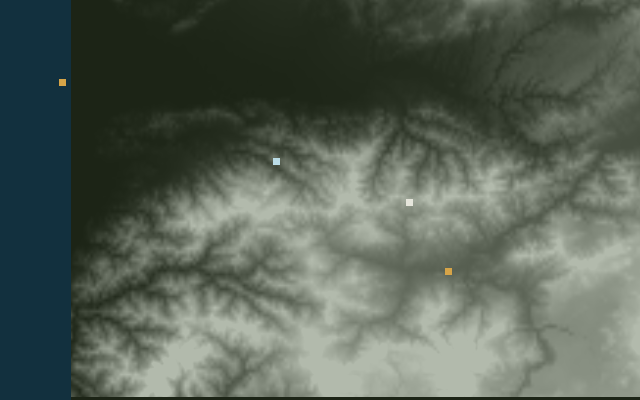

# Gale

A Zig simulation of two passive listening posts in Georgia. It combines simulated aircraft broadcasts with bearing and path-delay measurements, keeps a track history, and checks what happens when terrain blocks a receiver.

The posts sit at Poti and Akhaltsikhe. Mtatsminda's television tower is the assumed illuminator. Measurements and aircraft paths are generated locally; the program does not receive radio signals or connect to a live aircraft feed.

## Preview

The current output is a set of files. The program has no interactive dashboard yet.


The model contains a base, mast, receiver, two panels, and a camera. It is a rough assembly of boxes exported as STL, rather than a fabrication-ready design.



The map uses the bundled elevation grid. Gold marks indicate the two posts, the pale mark is Zekari, and blue marks show the remaining tracks. This is a final snapshot, not a live display.

## Run

Use Zig **0.17.0**, the version used for this build. There are no external Zig dependencies. Run these commands from this directory:

```sh
zig build test --summary all
zig build run
```

The run writes four files under `out/`:

- `post.stl`: the listening-post model.
- `post.ppm`: a render of that model.
- `map.ppm`: the terrain and final tracks from the shadow scenario.
- `journal.txt`: track states from all six scenarios.

PPM is an image format. The PNGs above are saved previews of those outputs.

## What the tests cover

Eight checks cover the elevation grid and six fixed scenarios: a broadcasting aircraft, crossing broadcasts, an aircraft without a callsign, a terrain shadow, a Kutaisi arrival, and clutter. The last check compares two runs of the same scenario byte for byte.

These are regression checks for the simulated cases. They do not establish real-world detection accuracy. The final-approach region is a simplified geometric rule, and a callsign is treated as civil within these examples; neither is an operational identification method.

## Code

- `src/geo.zig`: coordinates, named sites, and the simplified approach region.
- `src/ground.zig`: elevation lookup and terrain visibility.
- `src/ear.zig`: bearing and bistatic path geometry.
- `src/track.zig`: association, track state, and camera cue decisions.
- `src/run.zig`: repeatable scenarios and journal formatting.
- `src/solid.zig`: box geometry, STL export, and image rendering.
- `src/main.zig`: runs the scenarios and writes the outputs.

## Elevation

`src/ground.bin` contains a small grid sampled from public SRTM tiles served by the [AWS Terrain Tiles dataset](https://registry.opendata.aws/terrain-tiles/). The download addresses and grid dimensions are in `tools/ground.py`.

To rebuild it, run `python tools/ground.py`. That downloads six tiles and samples them into the bundled grid. Python is only needed for this step. The simulator itself runs offline.
